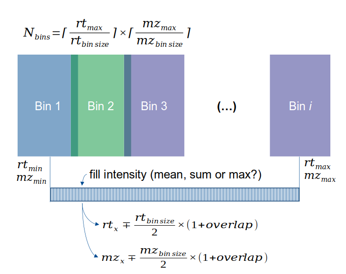

```{r setup, include=FALSE}
library(data.table)
library(dplyr)
library(stats)
library(Rcpp)
library(knitr)
library(kableExtra)
library(magrittr)
library(ggplot2)
library(plotly)
library(StreamFind)
knitr::opts_chunk$set(echo = TRUE, fig.align = "center", fig.width = 9, results = "markup")
options(width = 400)
```

```{r logo, echo=FALSE}
path_extdata <- system.file(package = "StreamFindData", dir = "extdata")
logo <- file.path(path_extdata, "logo_iuta.png")
htmltools::img(src = knitr::image_uri(logo), style = "margin-left:inherit;position:absolute;top:80px;left:740px;width:100px;")
```

<br>

***

```{r resources, include=FALSE}
files <- list.files(paste0(getwd(), "/MassSpectra"), pattern = "mzML", full.names = TRUE)
msEngine <- MassSpecData$new(files)
msEngine$add_blank_names(rep("blank", 8))

ramanFiles <- list.files(paste0(getwd(), "/RamanSpectra"), pattern = ".asc", full.names = TRUE)
ramanEngine <- RamanData$new(ramanFiles)
ramanEngine$add_replicate_names(c(rep("Sample", 11), rep("Blank", 11)))
ramanEngine$add_blank_names(rep("Blank", 22))
```

# MS

```{r, results='markup'}
msEngine
```

```{r ,echo=FALSE,fig.cap="Extracted ion chromatograms of Paracetamol (151 Da).",message=FALSE}
msEngine$plot_eic(mass = 151, ppm = 1500, colorBy = "analyses")
```

```{r ,echo=FALSE,fig.cap="Spectra of Paracetamol analysis at 100 ng/ml (cal_100).",message=FALSE}
msEngine$plot_spectra(analyses = 5, mz = data.table(mzmin = 100, mzmax = 300), minIntensityMS1 = 20E6)
```

<br>

## Make bins

```{r echo=FALSE, out.width="120%", fig.align = "center", fig.cap="Concept for binning the MS data."}

```

<br>

```{r}
make_bins <- function(data, rt_bin_size, mz_bin_size) {
  
  max_rt <- max(data$rt)
  min_rt <- min(data$rt)

  max_mz <- max(data$mz)
  min_mz <- min(data$mz)
  
  rts_all <- seq(round(min_rt, digits = 0), round(max_rt , digits = 0), rt_bin_size)
  mzs_all <- seq(round(min_mz, digits = 0), round(max_mz , digits = 0), mz_bin_size)

  bins_number <- length(rts_all) * length(mzs_all)
  
  bins_id <- rep(NA_character_, bins_number)
  
  mat <- matrix(rep(1, bins_number * 2), nrow = bins_number, ncol = 2)
  
  counter <- 0
  
  for (i in seq_len(length(rts_all))) {
    for (j in seq_len(length(mzs_all))) {
      bins_id[counter + j] <- paste0(rts_all[i], "-", mzs_all[j])
      mat[counter + j, 1] <- rts_all[i]
      mat[counter + j, 2] <- mzs_all[j]
    }
    counter <- counter + j
  }
  
  dimnames(mat) <- list(bins_id, c("rt", "mz"))
  
  mat <- as.data.frame(mat)

  return(mat)
}
```

<br>

```{r , message=FALSE}
# MS spectra example
ms100 <- msEngine$get_spectra(analyses = 5, mz = data.table(mzmin = 100, mzmax = 300), minIntensityMS1 = 20E6)
ms100 <- ms100[, c("rt", "mz", "intensity"), with = FALSE]
head(ms100)

rt_bin_size <- 5
mz_bin_size <- 2

bins <- make_bins(ms100, rt_bin_size, mz_bin_size)
```

```{r}
head(bins)

nrow(bins)
```

<br>

## Fill bins (per analysis)

```{r}
sourceCpp("fill_bins.cpp")

ints100 <- fill_bins(
  ms100,
  bins,
  rt_bin_size = 5,
  mz_bin_size = 2,
  overlap = 0.1, # a fraction of the bin size
  summaryFunction = "max"
)

paraBin <- "40-152"
paraBinN <- which(rownames(bins) %in% paraBin)
paraBinN
```

```{r ,echo=FALSE,fig.cap="Bins filled with analysis from Paracetamol at 100 ng/ml. The green dot is the bin correcpondent of Paracetamol peak."}
plot(seq_len(length(ints100)), ints100, type = "l", ylab = "Intensity", xlab = "Bins")
paraBin <- "40-152"
paraBinN <- which(rownames(bins) %in% paraBin)
points(x = paraBinN, y = ints100[paraBinN], pch = 19, cex = 2, col = "darkgreen")
```

<br>

## Blank subtraction

```{r , message=FALSE}
# Blank MS spectra
msBlank <- msEngine$get_spectra(analyses = 1, mz = data.table(mzmin = 100, mzmax = 300), minIntensityMS1 = 20E6)
msBlank <- msBlank[, c("rt", "mz", "intensity"), with = FALSE]

intsBlank <- fill_bins(
  msBlank,
  bins,
  rt_bin_size = 5,
  mz_bin_size = 2,
  overlap = 0.1, # a fraction of the bin size
  summaryFunction = "max"
)
```

```{r ,echo=FALSE,fig.cap="Bins from analysis of Paracetamol at 100 ng/ml (black) and blank (red). The green dot is the bin correcpondent of Paracetamol peak."}
plot(seq_len(length(ints100)), ints100, type = "l", ylab = "Intensity", xlab = "Bins")
lines(seq_len(length(intsBlank)), intsBlank, type = "l", col = "darkred")
points(x = paraBinN, y = ints100[paraBinN], pch = 19, cex = 2, col = "darkgreen")
```

<br>

```{r}
# Blank subtraction
ints100Corr <- ints100 - intsBlank
# Zeroing negative values
ints100Corr[ints100Corr < 0] <- 0
```

```{r ,echo=FALSE,fig.cap="Blank subtracted from bins of analysis from Paracetamol at 100 ng/ml. The green dot is the bin correcpondent of Paracetamol peak."}
plot(seq_len(length(ints100Corr)), ints100Corr, type = "l", ylab = "Intensity", xlab = "Bins")
points(x = paraBinN, y = ints100Corr[paraBinN], pch = 19, cex = 2, col = "darkgreen")
```

<br>

## Wrapper function

```{r}
prepareMsData <- function(spectra, rt_bin_size, mz_bin_size, overlap, blankAnalysis) {
  
  spectraList <- split(spectra[spectra$level == 1, c("rt", "mz", "intensity"), with = FALSE], spectra$analysis)
  
  bins <- make_bins(spectraList[[1]], rt_bin_size, mz_bin_size)
  
  # TODO before filling the bins might be needed to align across analyses
  
  intsList <- lapply(spectraList, function(x, bins, rt_bin_size, mz_bin_size, overlap) {
    fill_bins(x, bins, rt_bin_size, mz_bin_size, overlap, "max")
  },
  bins = bins,
  rt_bin_size = rt_bin_size,
  mz_bin_size = mz_bin_size,
  overlap = overlap
  )
  
  intsBlank <- intsList[[blankAnalysis]]
  
  intsList <- intsList[!names(intsList) %in% blankAnalysis]
  
  intsList <- lapply(intsList, function(x, intsBlank) {
    # blank subtraction
    x <- x - intsBlank
    # exclude negative intensity
    x[x < 0] <- 0
    # scale
    x <- x / sd(x)
    #block weighting
    x <- x / sqrt(length(x))
    # mean centering
    x <- x - mean(x)
    x
  }, intsBlank = intsBlank)
  
  matrix(
    unlist(intsList),
    nrow = length(intsList), ncol = length(bins$rt),
    byrow = TRUE,
    dimnames = list(
      names(intsList),
      rownames(bins)
    )
  )
}
```

<br>

```{r, message=FALSE}
spectra <- msEngine$get_spectra(mz = data.table(mzmin = 100, mzmax = 300), minIntensityMS1 = 20E6)

blankAnalysis <- msEngine$get_analysis_names()[1]

analysesMat <- prepareMsData(
  spectra,
  rt_bin_size = 5,
  mz_bin_size = 2,
  overlap = 0.1, # a fraction of the bin size
  blankAnalysis
)
```

```{r ,echo=FALSE,fig.cap="All MS analyses after bin filling, blank subtraction, mean centering and scaling."}
cl <- StreamFind:::.get_colors(rownames(analysesMat))
fig <- plot_ly()
xVal <- seq_len(length(analysesMat[1, ]))
for (i in seq_len(nrow(analysesMat))) {
  fig <- fig %>% add_trace(
    x = xVal,
    y = analysesMat[i, ],
    type = "scatter", mode = "lines",
    line = list(width = 0.5, color = unname(cl[i])),
    name = names(cl)[i],
    legendgroup = names(cl)[i],
    showlegend = TRUE
  )
  
  fig <- fig %>% add_trace(
    x = paraBinN,
    y = analysesMat[i, ][paraBinN],
    type = "scatter", mode = "markers",
    marker = list(size = 10, color = unname(cl[i])),
    name = names(cl)[i],
    legendgroup = names(cl)[i],
    showlegend = FALSE
  )
}
xaxis <- list(
  linecolor = toRGB("black"),
  linewidth = 2, title = "Bins",
  titlefont = list(size = 12, color = "black")
)
yaxis <- list(
  linecolor = toRGB("black"),
  linewidth = 2, title = "Intensity",
  titlefont = list(size = 12, color = "black")
)
fig <- fig %>% plotly::layout(xaxis = xaxis, yaxis = yaxis)
fig
```

<br>

# Raman

```{r, results='markup'}
ramanEngine
```

<br>

```{r ,echo=FALSE,fig.cap="Example spectra for Raman."}
ramanEngine$plot_spectra()
```

<br>

## Average spectra

```{r}
averageRamanSpectra <- function(spectra) {
  
  if (length(unique(spectra$analysis)) > 1) {
    split_vec <- spectra$analysis
    spectra[["analysis"]] <- NULL
    spectra <- split(spectra, split_vec)
    
  } else {
    analysis <- unique(spectra$analysis)
    spectra[["analysis"]] <- NULL
    spectra <- list(spectra)
    names(spectra) <- analysis
  }
  
  ints <- lapply(spectra, function(x) x$intensity)
  
  ints <- Reduce(`+`, ints) / length(ints)
  
  averageSpectra <- data.table(
    "shift" = spectra[[1]][["shift"]],
    "intensity" = ints
  )
  
  averageSpectra
}
```

```{r}
sampleSpectra <- ramanEngine$get_spectra(analyses = c(1:11))
sampleSpectraAv <- averageRamanSpectra(sampleSpectra)

blankSpectra <- ramanEngine$get_spectra(analyses = c(12:22))
blankSpectraAv <- averageRamanSpectra(blankSpectra)
```

```{r ,echo=FALSE,fig.cap="Averaged spectra for the Sample (black) and Blank (red)."}
plot(sampleSpectraAv, type = "l", ylab = "Intensity", xlab = "Bins")
lines(blankSpectraAv, type = "l", col = "darkred")
```

```{r ,echo=FALSE,fig.cap="Average effect zoomed."}
cl <- StreamFind:::.get_colors(c("samples", "averaged"))
ana <- unique(sampleSpectra$analysis)
fig <- plot_ly()
xVal <- seq_len(length(sampleSpectraAv$shift))[520:540]
for (i in seq_len(length(unique(sampleSpectra$analysis)))) {
  fig <- fig %>% add_trace(
    x = xVal,
    y = sampleSpectra$intensity[sampleSpectra$analysis %in% ana[i]][xVal],
    type = "scatter", mode = "lines",
    line = list(width = 0.5, color = unname(cl[1])),
    name = names(cl)[1],
    legendgroup = names(cl)[1],
    showlegend = ifelse(i == 1, TRUE, FALSE)
  )
}

fig <- fig %>% add_trace(
    x = xVal,
    y = sampleSpectraAv$intensity[xVal],
    type = "scatter", mode = "lines",
    line = list(width = 1.5, color = unname(cl[2])),
    name = names(cl)[2],
    legendgroup = names(cl)[2],
    showlegend = TRUE
  )

xaxis <- list(
  linecolor = toRGB("black"),
  linewidth = 2, title = "Bins",
  titlefont = list(size = 12, color = "black")
)
yaxis <- list(
  linecolor = toRGB("black"),
  linewidth = 2, title = "Intensity",
  titlefont = list(size = 12, color = "black")
)
fig <- fig %>% plotly::layout(xaxis = xaxis, yaxis = yaxis)
fig
```

<br>

## Trimming and blank subtraction

```{r}
sampleSpectraAv <- sampleSpectraAv[sampleSpectraAv$shift > 330]
blankSpectraAv <- blankSpectraAv[blankSpectraAv$shift > 330]
sampleSpectraAv$intensity <- sampleSpectraAv$intensity - blankSpectraAv$intensity
```

```{r ,echo=FALSE,fig.cap="Corrected spectra for the Sample."}
plot(sampleSpectraAv, type = "l", ylab = "Intensity", xlab = "Raman shift")
```

<br>

## Base line correction

```{r}
baselineCorrection <- function(spectra, lambda = 5, p = 0.05, maxit = 10) {
  mat <- matrix(as.numeric(spectra$intensity), nrow = 1, dimnames = list(1, spectra$shift))
  # Do own baseline correction for better control
  baseOut <- baseline::baseline.als(mat, lambda = lambda, p = p, maxit = maxit)
  
  data.table(
    "shift" = spectra$shift,
    "original" = spectra$intensity,
    "baseline" = baseOut$baseline[1, ],
    "corrected" = baseOut$corrected[1, ]
  )
}

sampleSpectraCorr <- baselineCorrection(sampleSpectraAv)
```

```{r ,echo=FALSE,fig.cap="Baseline (red) correction for the Sample spectrum (black) with corrected spectrum colored green."}
plot(sampleSpectraCorr$original, type = "l", ylim = c(0, 6000))
lines(sampleSpectraCorr$baseline, type = "l", col = "darkred")
lines(sampleSpectraCorr$corrected, type = "l", col = "darkgreen")
```

## Wrapper function

```{r}

prepareRamanData <- function(spectra, lambda = 5, p = 0.05, maxit = 10, blankAnalysis = NULL) {
  # make wrapper function
}

# scale
sampleSpectraCorr$corrected <- sampleSpectraCorr$corrected / sd(sampleSpectraCorr$corrected)
#block weighting
sampleSpectraCorr$corrected <- sampleSpectraCorr$corrected / sqrt(length(sampleSpectraCorr$corrected))
# mean centering
sampleSpectraCorr$corrected <- sampleSpectraCorr$corrected - mean(sampleSpectraCorr$corrected)
# lift base
sampleSpectraCorr$corrected <- sampleSpectraCorr$corrected + abs(min(sampleSpectraCorr$corrected))

# TODO return a matrix with shift as col names and analyses per row

ramanMat <- matrix(sampleSpectraCorr$corrected, nrow = 1, dimnames = list(1, sampleSpectraCorr$shift))
```

```{r ,echo=FALSE,fig.cap="Scaled sample spectrum."}
plot(sampleSpectraCorr$corrected, type = "l")
```

<br>

# Fusion

```{r}
# For now we repeat the raman dataset for each MS analysis
for (i in seq_len(nrow(analysesMat) - 1)) {
  ramanMat <- rbind(ramanMat, ramanMat[1, , drop = FALSE])
}
rownames(ramanMat) <- rownames(analysesMat)

fusedMat <- cbind(analysesMat, ramanMat)
```

```{r ,echo=FALSE,fig.cap="Fused data."}
cl <- StreamFind:::.get_colors(rownames(fusedMat))
fig <- plot_ly()
xVal <- seq_len(length(fusedMat[1, ]))
for (i in seq_len(nrow(fusedMat))) {
  fig <- fig %>% add_trace(
    x = xVal,
    y = fusedMat[i, ],
    type = "scatter", mode = "lines",
    line = list(width = 0.5, color = unname(cl[i])),
    name = names(cl)[i],
    legendgroup = names(cl)[i],
    showlegend = TRUE
  )
}
xaxis <- list(
  linecolor = toRGB("black"),
  linewidth = 2, title = "Bins",
  titlefont = list(size = 12, color = "black")
)
yaxis <- list(
  linecolor = toRGB("black"),
  linewidth = 2, title = "Intensity",
  titlefont = list(size = 12, color = "black")
)
fig <- fig %>% plotly::layout(xaxis = xaxis, yaxis = yaxis)
fig
```

# Simple PCA

```{r ,echo=FALSE,fig.cap="Simple PCA.", fig.width=9}
data_pca <- prcomp(fusedMat, center = TRUE, scale. = FALSE)

pcs <- data_pca$x
pc_data <- data.frame(PC1 = pcs[, 1], PC2 = pcs[, 2], Species = rownames(pcs))

pca_plot <- plot_ly(
  data = pc_data,
  x = ~PC1,
  y = ~PC2,
  type = "scatter",
  mode = "markers+text",
  text = ~Species,
  textfont = list(size = 14),  # Adjust the font size
  marker = list(size = 12),    # Adjust the marker size
  textposition = "top center"  # Place text on top of the dots
) %>%
  layout(
    title = "PCA Plot with Annotations",
    xaxis = list(title = "Principal Component 1"),
    yaxis = list(title = "Principal Component 2")
  )

# Show the plot
pca_plot


```

<br>
<br>

```{r ,echo=FALSE,fig.cap="PCA loadings.", fig.width=9}

loadings <- as.data.frame(data_pca$rotation[, 1:2])

# Create a scatter plot for loadings using Plotly
loadings_plot <- plot_ly(
  data = loadings,
  x = ~PC1,
  y = ~PC2,
  type = "scatter",
  mode = "markers+text",
  text = rownames(loadings),
  textfont = list(size = 14),
  marker = list(size = 10)
) %>%
  layout(
    title = "PCA Loadings Plot",
    xaxis = list(title = "Principal Component 1"),
    yaxis = list(title = "Principal Component 2")
  )

# Show the plot
loadings_plot
```

